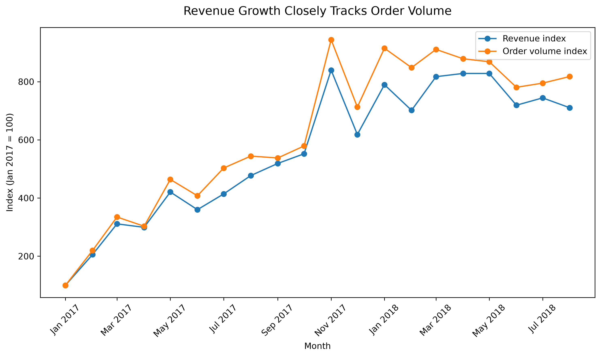
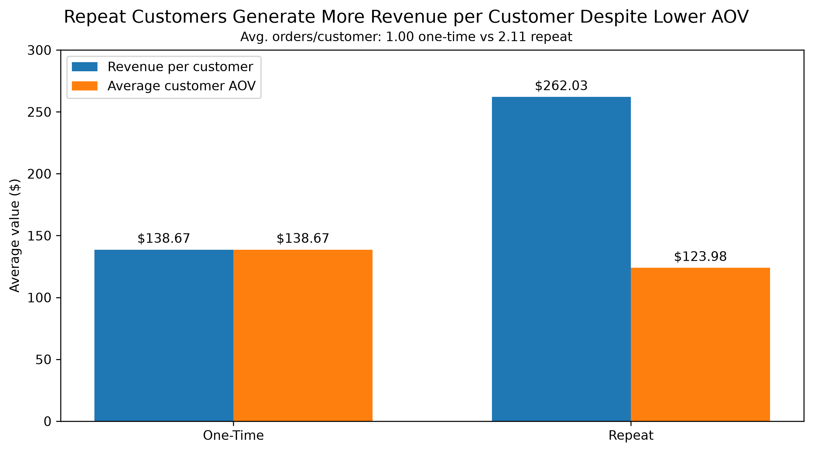
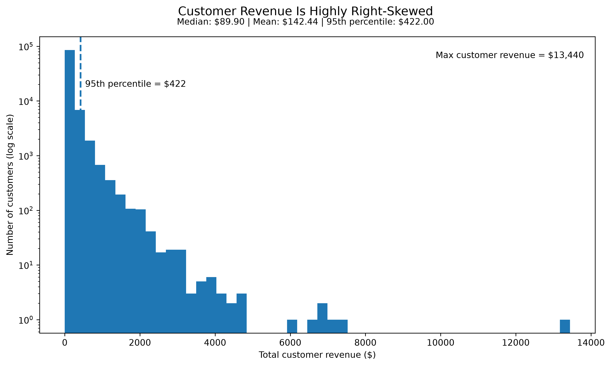
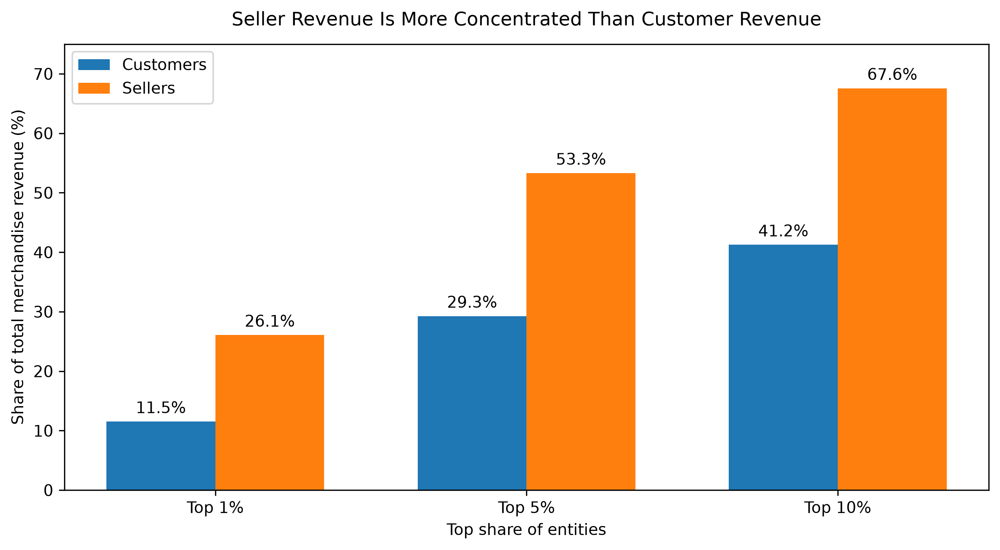

# Understanding, Segmenting, and Predicting Customer Value in a Two-Sided E-Commerce Marketplace

## Overview

This project investigates how a two-sided e-commerce marketplace can identify, understand, and prioritize customer value and repeat-purchase opportunity using relational transaction data.

The analysis begins by establishing a trustworthy data foundation through validation of customer identity, table grain, key relationships, missingness, and join behavior. It then examines marketplace growth, product-category economics, customer value, repeat-purchase behavior, and revenue concentration across both customers and sellers using PostgreSQL, SQL, Python, and pandas.

The project is built around a simple principle: **good analysis starts with trustworthy data**.

The broader analytical arc moves from descriptive marketplace and customer economics into customer segmentation, marketing and consumer insights, and predictive modeling designed to support retention and targeting decisions.

---

## Key Results

The analysis completed so far has identified several important patterns:

- **Marketplace growth was primarily volume-driven.** Revenue closely tracked order-volume growth across the reliable monthly observation window, while average order value remained comparatively stable.

- **Repeat customers were substantially more valuable per customer.** Repeat customers generated approximately **$262 in merchandise revenue per customer**, compared with approximately **$139 for one-time customers**.

- **Repeat-customer value came from frequency rather than larger orders.** Repeat customers averaged approximately **2.11 orders** but had a lower average customer AOV than one-time customers.

- **Customer revenue is highly right-skewed.** Median customer revenue was approximately **$89.90**, compared with a mean of **$142.44**, a 95th percentile of **$422**, and a maximum of **$13,440**.

- **Seller-side revenue is considerably more concentrated than customer-side revenue.** The top 10% of sellers generated approximately **67.6%** of merchandise revenue, compared with approximately **41.2%** for the top 10% of customers.

- **Product categories have different economic profiles.** High revenue can emerge through high sales volume, higher item value, or a combination of the two rather than through one common category pattern.

- **Category revenue is moderately concentrated.** The top five categories generated approximately **39.7%** of merchandise revenue, while the top ten generated approximately **62.4%**.

These findings establish the economic structure that motivates the next stages of the project: customer segmentation, retention analysis, and predictive modeling.

---

## Business Problem

### Primary Question

> **How can a two-sided e-commerce marketplace identify, understand, and prioritize customer value and repeat-purchase opportunity?**

### Supporting Questions

- What drives marketplace revenue growth: order volume, order value, or both?
- How do product categories differ in their volume-value economics?
- How does repeat purchasing relate to customer value?
- How unevenly is customer value distributed?
- How concentrated is marketplace revenue across customers and sellers?
- Which customer behavioral patterns support meaningful segmentation?
- Can repeat-purchase opportunity be predicted reliably enough to support retention and targeting decisions?

---

## Analytical Roadmap

The project is structured as a progressive data-science workflow:

```text
Trustworthy data foundations
        ↓
Marketplace & customer economics
        ↓
Customer segmentation
        ↓
Marketing & consumer insights
        ↓
Predictive modeling
        ↓
Decision support & reproducibility
```

### Stage 1 — Trustworthy Data Foundations

Validate relational structure, analytical grain, customer identity, missingness, keys, and join behavior before calculating customer or marketplace metrics.

### Stage 2 — Marketplace & Customer Economics

Analyze revenue growth, order volume, average order value, category economics, customer value, repeat behavior, and marketplace concentration.

### Stage 3 — Customer Segmentation

Construct customer-level behavioral features and evaluate whether stable, interpretable, and actionable customer segments exist.

### Stage 4 — Marketing & Consumer Insights

Connect customer behavior and segments to audience, channel, creative, and consumer-response questions using statistical analysis and carefully scoped marketing data.

### Stage 5 — Predictive Modeling

Develop leakage-aware models for a business-relevant customer outcome such as repeat purchase, using temporal validation, baseline comparisons, and business-aligned evaluation metrics.

### Stage 6 — Decision Support & Reproducibility

Translate the analysis into recommendations, model interpretation, limitations, reproducible workflows, and decision-support outputs.

---

## Tech Stack

### Data Analysis & Visualization

- Python
- pandas
- Jupyter Notebook
- Matplotlib

### Database & Querying

- PostgreSQL
- SQL

### Development & Version Control

- VS Code
- Git
- GitHub

### Planned Statistical & Modeling Work

- customer segmentation
- statistical inference
- supervised machine learning
- temporal validation
- model evaluation
- model interpretation

---

## Dataset

This project uses the **Olist Brazilian E-Commerce Public Dataset**, an anonymized commercial e-commerce dataset containing marketplace transactions from Brazil.

Seven core tables are used:

- `customers`
- `orders`
- `order_items`
- `products`
- `payments`
- `reviews`
- `sellers`

| Table | Rows |
|---|---:|
| Customers | 99,441 |
| Orders | 99,441 |
| Order Items | 112,650 |
| Products | 32,951 |
| Payments | 103,886 |
| Reviews | 99,224 |
| Sellers | 3,095 |

Together, these tables describe customer identities, purchases, order status, products, sellers, payments, and reviews.

---

## Data Model

The analysis uses the relational structure of the marketplace rather than flattening the source data without regard to table grain.

```text
customers
    |
    | customer_id
    v
orders
    |
    | order_id
    +----------------------+
    |                      |
    v                      v
order_items             payments
    |
    | product_id
    v
products

order_items
    |
    | seller_id
    v
sellers

orders
    |
    | order_id
    v
reviews
```

### Customer Identity

A critical early validation was the distinction between `customer_id` and `customer_unique_id`.

- `customer_id` identifies customer records and is used to join `customers` to `orders`.
- `customer_unique_id` represents the underlying customer across records and is used for repeat-purchase and customer-level analysis.

Multiple customer records can correspond to the same underlying customer. Using `customer_id` as the customer-level identity would therefore distort repeat-customer metrics and downstream customer-value analysis.

---

## 1. Trustworthy Data Foundations

Before analyzing marketplace or customer behavior, I established a trustworthy relational foundation for downstream analysis.

The purpose of this stage was not simply to clean the data. It was to determine whether the source tables, identifiers, relationships, and analytical grains could support reliable customer-, order-, seller-, and marketplace-level metrics.

### Python / pandas Audit

The seven source tables were first audited in Python using pandas.

Validation included:

- row and column counts
- data-type inspection
- missing-value analysis
- duplicate-row checks
- primary and composite-key validation
- customer-identity validation
- order-lifecycle investigation
- relationship and join-risk checks
- monetary distribution analysis

### Key Findings

- `customers` contains **99,441** customer records.
- `customer_id` is unique while `customer_unique_id` can repeat across records.
- `orders` contains **99,441 unique order IDs**.
- `order_id + order_item_id` uniquely identifies rows in `order_items`.
- `order_id + payment_sequential` uniquely identifies rows in `payments`.
- `product_id` is unique in `products`.
- `seller_id` is unique in `sellers`.
- Review records require careful handling because neither `review_id` nor `order_id` is unique at the row level.
- Some product metadata is missing.
- Price and freight distributions are right-skewed.
- Missing delivery-related timestamps are largely associated with orders that had not completed the delivery lifecycle.

### Analytical Decisions

The audit directly informed later analysis:

- use `customer_id` for customer-to-order joins
- use `customer_unique_id` for customer-level behavior
- interpret lifecycle missingness in the context of order status
- validate analytical grain before aggregating after joins
- account for orders that do not appear in `order_items`
- treat review joins cautiously
- use medians and percentiles alongside means for skewed monetary variables

These decisions form the measurement foundation for every downstream customer and marketplace metric.

---

## 2. PostgreSQL Validation

After auditing the source data in Python, I loaded the seven core tables into PostgreSQL.

Database-level checks were then used to verify consistency between the source files and relational database.

Validation included:

- table row counts
- key integrity
- order-status distributions
- payment-type distributions
- expected table relationships

The PostgreSQL results matched the earlier pandas audit, providing an additional validation layer before business analysis.

---

## 3. Marketplace Performance

### Revenue Definition

Unless otherwise stated:

> **Merchandise revenue = `SUM(order_items.price)`**

Freight is excluded from merchandise revenue.

### Baseline Marketplace Metrics

- **99,441 total orders**
- **96,096 unique customers**
- approximately **$13.59M in merchandise revenue**
- approximately **$137.75 average merchandise value per order**

These metrics establish marketplace scale. The deeper analysis focuses on the mechanisms behind marketplace growth and customer value.

---

### Revenue Growth vs Order Volume

Monthly revenue, order volume, and average order value were analyzed together.

The beginning and end of the dataset contain sparse partial months. These observations were retained in the underlying data but excluded from the primary indexed comparison because they would distort relative growth.

The final comparison uses the reliable period from **January 2017 through August 2018**.

Revenue and order volume were normalized to a common baseline:

```text
January 2017 = 100
```

This allows revenue measured in dollars and order volume measured in counts to be compared through their relative movement over time.

### Finding

Revenue and order volume move closely together.

Order volume generally grew somewhat faster than revenue relative to the January 2017 baseline, while average order value remained comparatively stable.

This indicates that observed marketplace revenue growth was primarily associated with increasing transaction volume rather than sustained increases in order value.



---

## 4. Product Category Economics

Revenue rankings alone do not explain **why** categories generate revenue.

To investigate the underlying economics, I compared:

- items sold
- average item value
- merchandise revenue

Category sales volume is strongly right-skewed, so the final visualization uses a logarithmic x-axis for `items_sold` while retaining average item value on a linear dollar scale.

### Selected Category Profiles

- **Bed Bath Table** — very high volume with relatively low average item value
- **Beauty & Health** — high volume with moderate average item value
- **Watches & Gifts** — meaningful volume combined with substantially higher item value
- **Phone Accessories** — relatively high volume with low average item value
- **PCs** — very low volume with exceptionally high average item value

### Category Revenue Concentration

Merchandise revenue is moderately concentrated across categories:

- top 5 categories: approximately **39.7%**
- top 8 categories: approximately **54.4%**
- top 10 categories: approximately **62.4%**
- top 20 categories: approximately **84.0%**

No single category dominates the marketplace, but a relatively small set contributes a substantial share of merchandise revenue.

---

## 5. Customer Economics

### Customer-Level Analytical Grain

Customer economics are measured at the `customer_unique_id` level.

The reusable customer-level analytical dataset includes:

- total merchandise revenue
- order count
- average order value
- first purchase date
- last purchase date
- one-time vs repeat status

The merchandise-revenue customer dataset contains **95,420 customers represented in `order_items`**.

This differs from the full **96,096 unique customers** because some customers have orders without corresponding rows in the order-item table and therefore cannot contribute to merchandise-revenue calculations.

---

### One-Time vs Repeat Customer Value

For customers represented in the merchandise-revenue analysis:

| Customer Type | Customers | Avg. Revenue per Customer | Avg. Customer AOV | Avg. Orders per Customer |
|---|---:|---:|---:|---:|
| One-Time | 92,507 | ~$138.67 | ~$138.67 | 1.00 |
| Repeat | 2,913 | ~$262.03 | ~$123.98 | ~2.11 |

Repeat customers generate substantially more merchandise revenue per customer despite having **lower average order value**.

The value difference is therefore primarily associated with **purchase frequency rather than larger individual orders**.



### Decision Relevance

Repeat purchase is therefore an economically meaningful customer outcome.

This motivates later segmentation and predictive modeling focused on identifying customers with greater repeat-purchase opportunity.

---

## 6. Customer Revenue Distribution

Customer merchandise revenue is strongly right-skewed.

| Metric | Customer Revenue |
|---|---:|
| Minimum | $0.85 |
| Median | $89.90 |
| Mean | $142.44 |
| 75th percentile | $155 |
| 90th percentile | $284 |
| 95th percentile | $422 |
| Maximum | $13,440 |

The mean is substantially higher than the median, while the maximum is far beyond the upper percentiles.

This means average customer revenue alone is not representative of the broader customer population.

Most customers generate relatively modest merchandise revenue while a small high-value tail reaches substantially larger values.



This heterogeneity provides a direct motivation for customer segmentation rather than treating the customer base as economically uniform.

---

## 7. Customer vs Seller Revenue Concentration

Olist operates as a two-sided marketplace, so revenue concentration was evaluated on both the demand and supply sides.

Customers and sellers were separately ranked by merchandise revenue and divided into percentiles.

| Revenue Cutoff | Customers | Sellers |
|---|---:|---:|
| Top 1% | 11.53% | 26.07% |
| Top 5% | 29.26% | 53.30% |
| Top 10% | 41.25% | 67.56% |



### Finding

Seller-side revenue is substantially more concentrated than customer-side revenue.

The top 10% of sellers account for approximately **67.6%** of merchandise revenue compared with approximately **41.2%** for the top 10% of customers.

This reveals stronger supply-side revenue concentration within the marketplace.

This result is descriptive rather than causal. The analysis does not establish what would happen if high-revenue sellers left the marketplace.

---

## 8. Business Implications

### Marketplace Growth

Revenue growth closely tracks order-volume growth while average order value remains comparatively stable.

The primary observed growth mechanism is therefore transaction volume rather than increasing basket value.

### Customer Retention

Repeat customers generate substantially more revenue per customer despite lower average order value.

Increasing purchase frequency and understanding second-purchase opportunity are therefore economically meaningful customer problems.

### Customer Heterogeneity

Customer revenue is strongly skewed.

A single average customer metric conceals substantial variation in customer economics, motivating segmentation and targeted analysis.

### Category Economics

Categories generate marketplace value through different combinations of volume and average item value.

Revenue rankings alone therefore provide an incomplete view of category economics.

### Marketplace Concentration

Seller revenue is significantly more concentrated than customer revenue.

This highlights supply-side concentration as an important marketplace characteristic alongside customer behavior.

---

## 9. Next Stage: Customer Segmentation

The next phase will construct customer-level behavioral features and test whether meaningful customer segments can be identified.

The goal is not to apply clustering simply because it is a common portfolio technique.

Segmentation will be evaluated based on:

- behavioral meaning
- cluster stability
- separation
- interpretability
- business actionability

Candidate features will include recency, frequency, monetary value, and other defensible customer-behavior measures.

The central question becomes:

> **Which customer groups differ meaningfully in value, purchase behavior, and repeat-purchase opportunity?**

---

## 10. Planned Marketing & Consumer Analysis

Customer segments will later be connected to marketing and consumer-response questions.

This stage will focus on questions such as:

- which customer segments differ in expected value or repeat behavior?
- how should targeting priorities differ across segments?
- how do audience, channel, or creative characteristics relate to response?
- where can statistical inference improve marketing decisions?

Any synthetic marketing data introduced later will be clearly labeled as synthetic and treated as a secondary analytical layer rather than as observed Olist behavior.

---

## 11. Planned Predictive Modeling

A later stage will evaluate whether repeat-purchase opportunity can be predicted from information available at a defined point in time.

The modeling workflow will emphasize:

- explicit target definition
- prediction timing
- point-in-time feature construction
- leakage prevention
- baseline models
- stronger comparison models
- temporal validation
- business-relevant evaluation metrics
- threshold selection
- model interpretation
- limitations and monitoring considerations

The objective is not simply to maximize predictive performance.

The goal is to determine whether customer behavior contains enough signal to support useful retention or targeting decisions.

---

## Limitations

Several limitations are important when interpreting the current analysis:

- The dataset represents historical Olist activity in Brazil and should not automatically be generalized to other markets.
- Sparse months occur at the beginning and end of the observation period.
- Merchandise revenue is defined using item price and excludes freight unless otherwise stated.
- Some orders do not contain corresponding `order_items` records.
- Customer merchandise-revenue analysis therefore covers only customers represented in `order_items`.
- Product metadata contains missing values.
- Review records require careful joins because identifiers are not unique at the row level.
- Revenue concentration describes observed marketplace structure but does not establish causal dependency.
- Repeat-customer comparisons are observational and should not be interpreted as the causal effect of repeat purchasing.
- Future segmentation and predictive models will require their own validation before being interpreted as decision-ready systems.

---

## Repository Structure

```text
olist-customer-growth-analytics/
│
├── data/
│   ├── raw/
│   │   └── [local Olist CSV files — not tracked in Git]
│   │
│   └── processed/
│       └── [generated locally from SQL — not tracked in Git]
│
├── notebooks/
│   ├── data_audit.ipynb
│   └── week2_visuals.ipynb
│
├── sql/
│   ├── 01_data_quality.sql
│   ├── 02_revenue_kpis.sql
│   └── 03_marketplace_customer_economics.sql
│
├── visuals/
│   ├── category_volume_value_drivers.png
│   ├── customer_revenue_distribution.png
│   ├── customer_vs_seller_revenue_concentration.png
│   ├── monthly_revenue_vs_order_volume.png
│   └── repeat_vs_one_time_customer_economics.png
│
├── .gitignore
└── README.md
```

The repository will continue to evolve as segmentation, statistical analysis, predictive modeling, and decision-support components are added.

---

## Reproducibility

The project separates:

- raw source data
- processed analytical extracts
- SQL transformations
- Python analysis
- presentation-ready visual outputs

Raw Olist CSV files are stored locally and excluded from Git.

Processed analytical extracts are generated locally from the SQL workflow and are also excluded from Git. The SQL files remain the source of truth for reproducible transformations, while the processed CSVs act as local handoff files for visualization in Python.

SQL is used to define relational transformations, analytical grains, and reusable business datasets. Python is used for validation, statistical inspection, transformation, and visualization.

---

## Project Principles

This project is designed to demonstrate an end-to-end data science workflow rather than a collection of unrelated techniques.

The analysis prioritizes:

- **data integrity over convenient assumptions**
- **business questions over technique accumulation**
- **correct analytical grain over mechanically joining tables**
- **distribution-aware statistics over relying on averages alone**
- **interpretable analysis over unnecessary complexity**
- **validation over impressive-looking models**
- **reproducibility over one-off results**
- **clear separation of descriptive, predictive, and causal claims**

The long-term objective is to connect trustworthy relational data, statistical reasoning, machine learning, and business interpretation into a defensible customer-value decision framework.